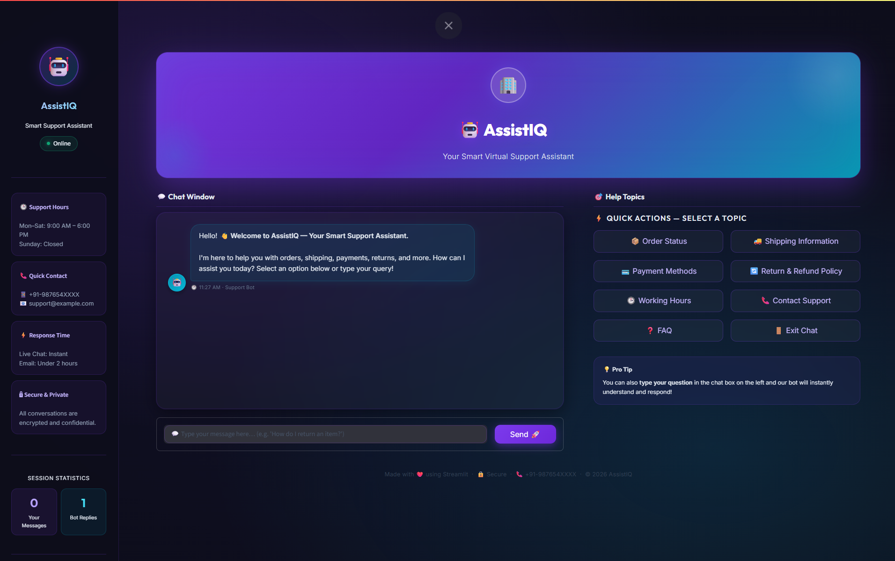
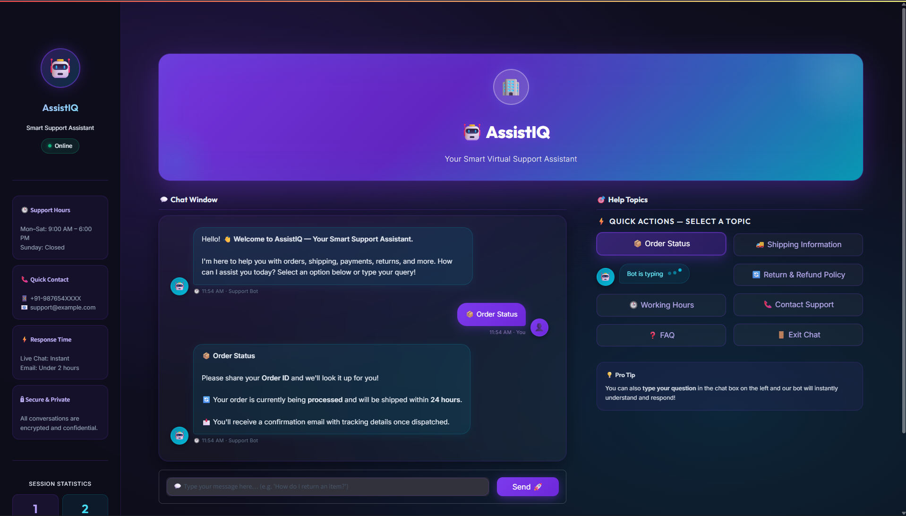
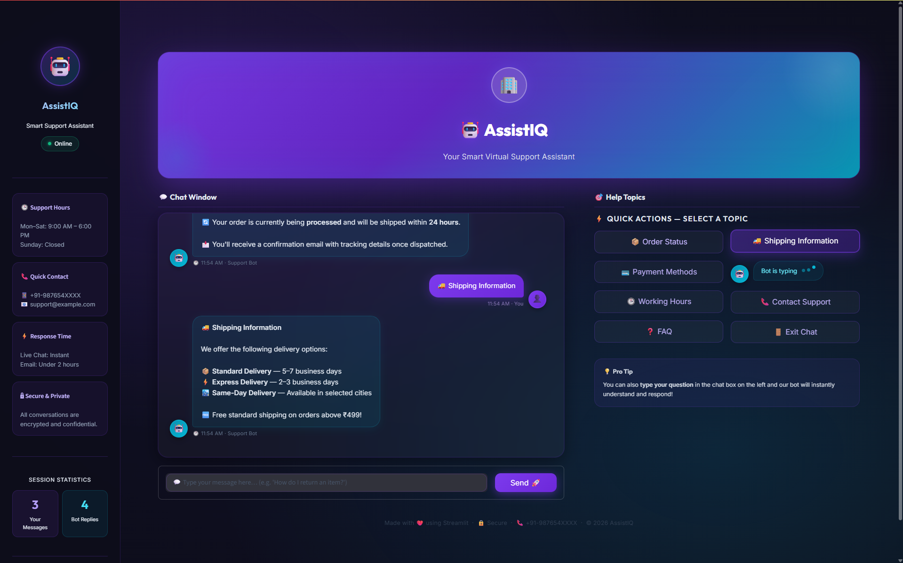
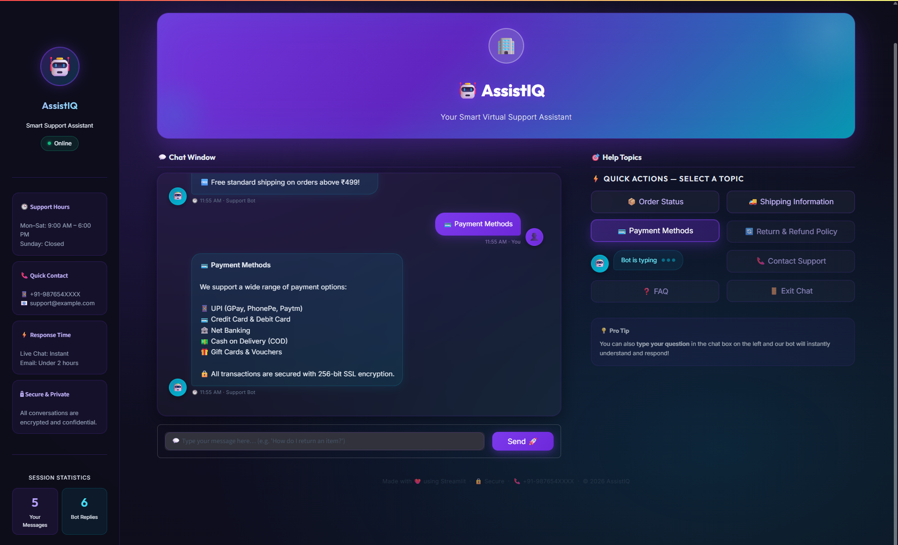

# 🤖 AssistIQ

<div align="center">


**A modern, fully rule-based smart support chatbot built with Python & Streamlit.**
No OpenAI API. No paid services. No database required.

</div>

---

## 📌 Project Overview

**AssistIQ** is a fully functional, rule-based virtual support assistant built using **Python** and **Streamlit**. It simulates a real-world customer support experience with a **premium dark glassmorphism UI** featuring animated chat bubbles, quick-action buttons, a live sidebar, and keyword-based intent classification — all without any external AI or paid API.

The project was developed as an **internship submission** demonstrating practical skills in:
- Python application development
- Streamlit UI design & session state management
- Rule-based NLP / intent classification
- Context-aware conversation handling
- Premium CSS design with dark glassmorphism, animated gradients, and micro-animations

---

## 🎨 Design Theme

AssistIQ uses a **premium dark glassmorphism** UI with a **violet + cyan** accent palette, inspired by modern AI products.

| Design Token | Value | Usage |
|---|---|---|
| 🌑 **Background** | `#0d0d1a` dark navy | App background with radial mesh gradient |
| 💜 **Primary Accent** | `#7c3aed` violet | User bubbles, buttons, glows |
| 🩵 **Secondary Accent** | `#06b6d4` cyan | Bot bubbles, avatars, typing dots |
| 🪟 **Surface** | `rgba(255,255,255,0.03–0.08)` | Glass cards, chat container |
| 🟢 **Status** | `#10b981` emerald | Online indicator with glow |
| 📝 **Text Primary** | `#e2e8f0` / `#f1f5f9` | Main content text |
| 📝 **Text Muted** | `#64748b` / `#94a3b8` | Timestamps, subtitles |
| 🔤 **Heading Font** | `Outfit` (800w) | Headings, logo, stats |
| 🔤 **Body Font** | `Inter` | All body text |

**Effects & Animations:**
- Animated floating orbs on the header card (`orb-float` keyframes)
- Pulsing glow on the logo circle (`logo-pulse` keyframes)
- Glowing green status dot (`pulse-dot` keyframes)
- Glowing violet hover on all quick-action buttons
- Frosted glass (`backdrop-filter: blur`) on sidebar, chat container, and cards
- Custom slim violet scrollbar
- Violet focus ring on text input

---

### 🎯 Objective

Develop a rule-based or simple NLP-based chatbot capable of answering basic customer queries while providing a user-friendly customer support experience.


---


## 🚀 What Can AssistIQ Do?

AssistIQ acts as a **24/7 virtual customer support agent**. Here's everything it can handle:

| Capability | Description |
|---|---|
| 📦 **Order Status** | Asks for an Order ID, then confirms order details and dispatch timeline |
| 🚚 **Shipping Info** | Explains Standard (5–7 days), Express (2–3 days), and Same-Day delivery options |
| 💳 **Payment Methods** | Lists UPI, Credit/Debit Card, Net Banking, COD, and Gift Cards |
| 🔄 **Return & Refund** | Explains 7-day return window and 5–7 business day refund process |
| 🕒 **Working Hours** | Tells users when support is available (Mon–Sat, 9 AM–6 PM) |
| 📞 **Contact Support** | Provides email, phone, live chat, and social media contact info |
| ❓ **FAQ** | Answers common questions about tracking, cancellations, refunds, and support |
| 🚪 **Exit Chat** | Ends the conversation with a polite farewell message |
| 🔤 **Free-Text Input** | Users can type naturally — the bot understands keywords and responds accordingly |
| 🔢 **Order ID Recognition** | After asking for an Order ID, the bot recognizes any numeric/alphanumeric input and gives a specific order update |
| 🧹 **Clear Chat** | Resets the entire conversation with one click |

---

## ⚙️ How It Works

AssistIQ uses a **rule-based approach** — no machine learning or AI model is involved. Instead, it uses a series of logical checks to understand the user's intent and pick the right response.

### Step-by-Step Flow

```
User Action
    │
    ▼
Click a Quick Action Button?
    │── YES ──▶ Map button label to a topic key
    │             ▼
    │           Show "Bot is typing..." animation (1.2 sec)
    │             ▼
    │           Look up pre-written response for that topic
    │             ▼
    │           Append bot reply to chat history
    │             ▼
    │           Auto-scroll chat to bottom → Rerun
    │
    └── NO ──▶ User typed a message in the text box
                 ▼
               Is it an Order ID? (digits / alphanumeric)
               AND was the last bot reply about Order Status?
                 │── YES ──▶ Respond with order confirmation for that specific ID
                 │
                 └── NO ──▶ Run keyword classifier on the message
                               │── Match found ──▶ Return topic response
                               └── No match   ──▶ Return "I didn't understand" message
```

---

## 🔬 How Each Function Works

Here is a detailed breakdown of every function in [`app.py`](app.py):

---

### `load_css()`
Injects a block of custom CSS into the Streamlit app using `st.markdown(unsafe_allow_html=True)`.

- Loads **Outfit** (headings) and **Inter** (body) fonts from Google Fonts
- Applies a **deep dark navy background** (`#0d0d1a`) with a radial violet + cyan mesh gradient
- Styles the **sidebar** as a dark glass panel (`rgba(13,13,26,0.95)`) with a violet border and `backdrop-filter: blur(20px)`
- Styles the **header card** with a violet→cyan gradient and two animated floating orbs (`::before`, `::after`)
- Defines styles for **chat bubbles** (user = violet gradient, bot = cyan-tinted glass with border)
- Creates the **typing animation** (three bouncing cyan dots)
- Adds **glowing violet hover effects** on quick-action buttons with `box-shadow`
- Styles the **Send button** as a solid violet gradient with a glow drop shadow
- Styles the **text input** with a dark glass background and violet focus ring
- Styles **info cards** in the sidebar with dark violet-tinted glassmorphism
- Custom **emerald green glowing status dot** (`pulse-dot` animation)
- Custom slim **violet scrollbar** (`::-webkit-scrollbar`)

---

### `get_bot_response(topic)`
The **core response engine**. Takes a topic key (e.g. `"order_status"`, `"shipping"`) and returns a pre-written HTML string.

```python
# Example
get_bot_response("shipping")
# Returns: "🚚 <b>Shipping Information</b>..."
```

All 8 responses are stored in a Python dictionary. HTML tags like `<b>`, `<br>`, `<i>` are used to format the message inside the chat bubble.

---

### `init_session()`
Runs once when the app first loads. Uses Streamlit's `st.session_state` to:

- Create the `messages` list (stores all chat history)
- Append the **welcome message** from the bot
- Set a `typing` flag used internally

This ensures the chat state persists across reruns without resetting.

---

### `render_chat()`
Loops through every message in `st.session_state.messages` and builds an HTML string with:

- A **bot avatar** (🤖, cyan gradient) or **user avatar** (👤, violet gradient)
- A styled **chat bubble** (violet for user, cyan glass for bot)
- A **timestamp** (formatted as `10:55 AM`)
- A hidden `#chat-scroll-anchor` `<div>` at the bottom
- A `<script>` that calls `scrollIntoView()` at **0ms, 120ms, and 350ms** after render to ensure the latest message is always visible

---

### `show_typing()`
Creates a temporary placeholder element that shows a **"Bot is typing..."** animation with three bouncing cyan dots.

```python
placeholder = st.empty()
placeholder.markdown("...typing HTML...")
time.sleep(1.2)   # simulate bot thinking
placeholder.empty()  # remove the indicator
```

This gives the chatbot a human-like feel before the response appears.

---

### `add_message(role, content)`
A simple helper that appends a new message dictionary to `st.session_state.messages`:

```python
{
    "role": "bot",          # or "user"
    "content": "...",       # HTML response string
    "time": "10:55 AM"      # current timestamp
}
```

---

### `render_sidebar()`
Builds the left sidebar with:

- A **robot logo** with a violet glow ring and gradient-text **"AssistIQ"** title
- A glowing **emerald Online** badge
- Four **dark glass info cards** (support hours, contact, response time, security)
- **Session statistics** — live count of user messages (violet tile) and bot replies (cyan tile)
- A **Clear Chat** button that resets messages and adds a fresh greeting

---

### `render_quick_actions()`
Renders **8 quick-action buttons** in a 2-column grid. When clicked:

1. The button label is added as a **user message**
2. The `show_typing()` animation plays
3. `get_bot_response()` returns the reply
4. The reply is added as a **bot message**
5. `st.rerun()` refreshes the UI

---

### `is_order_id(text)`
Uses Python's `re` module to detect if the user's input looks like an Order ID:

```python
re.fullmatch(r'\d{4,20}', stripped)           # pure digits: 24514521
re.fullmatch(r'[A-Za-z0-9]{4,20}(-[A-Za-z0-9]+)?', stripped)  # codes: ORD-1234
```

Returns `True` if matched, `False` otherwise.

---

### `get_last_bot_topic()`
Reads the last bot message from `st.session_state.messages` and checks if it contained an order-related prompt (i.e., the bot was asking for an Order ID).

Returns `'order_status'` if yes, or `''` if no. This is used to **detect conversation context**.

---

### `classify_message(text)`
A keyword-based intent classifier. Loops through a `KEYWORD_MAP` dictionary:

```python
KEYWORD_MAP = {
    "order": "order_status",
    "track": "order_status",
    "ship":  "shipping",
    "refund": "returns",
    ...
}
```

Converts the input to lowercase and checks if any keyword is a substring of the message. Returns the matched topic key, or `"unknown"` if nothing matches.

---

### `handle_text_input()`
The main text message handler. Renders a form with a dark-styled text box and violet **Send 🚀** button.

On submit:
1. Detects if input is an **Order ID** in an order-status context → gives order confirmation
2. Otherwise runs `classify_message()` to find the topic
3. Falls back to an "I didn't understand" reply if no match
4. Calls `show_typing()` → `add_message()` → `st.rerun()`

---

### `main()`
The **entry point** that assembles the full app:

1. `load_css()` — injects the dark glassmorphism styling
2. `init_session()` — sets up state
3. `render_sidebar()` — builds the dark glass sidebar
4. Renders the **header card** (animated logo + violet→cyan gradient title)
5. Creates a **3:2 column layout**:
   - Left (3): Chat window + text input
   - Right (2): Quick-action buttons + Pro Tip card
6. Renders the **footer**

---

## ✨ Features

| Feature | Description |
|---|---|
| 💬 **Chat Interface** | Animated chat bubbles — violet gradient for user, cyan glass for bot |
| ⚡ **Quick Actions** | 8 pre-built topic buttons with violet glow on hover |
| 🔤 **Free-Text Input** | Keyword-based intent classifier for typed queries |
| 🕐 **Timestamps** | Every message displays the send time |
| 🤖 **Typing Animation** | "Bot is typing…" cyan bouncing dots before each response |
| 🔢 **Order ID Detection** | Recognizes order IDs entered after the bot asks for one |
| 📊 **Session Statistics** | Live gradient-text message/reply counts in styled sidebar tiles |
| 🗑️ **Clear Chat** | Reset conversation with one click |
| 📱 **Responsive Layout** | Works on desktop and tablet |
| 🎨 **Premium Dark Theme** | Dark glassmorphism, violet/cyan accents, animated orbs, custom scrollbar |
| ✨ **Micro-Animations** | Floating orbs, pulsing logo glow, glowing status dot, bounce typing dots |
| 🔒 **Secure** | No external data storage — everything in session |

---

## 🛠️ Technologies Used

| Technology | Purpose |
|---|---|
| **Python 3.9+** | Core programming language |
| **Streamlit** | Web app framework & UI rendering |
| **HTML / CSS** | Custom dark glassmorphism styling via `st.markdown` |
| **Google Fonts** | `Outfit` (headings) + `Inter` (body) typography |
| **`re`** (stdlib) | Order ID pattern matching |
| **`datetime`** (stdlib) | Message timestamps |
| **`time`** (stdlib) | Typing animation delay |

> ✅ **No paid APIs. No database. No external AI services.**

---

## 📂 Project Structure

```
AssistIQ/
│
├── screenshots/
    ├── home.png
    ├── order-status.png
    ├── shipping.png
    ├── payment.png
├── app.py              # Main Streamlit application (all logic + UI)
├── requirements.txt    # Python dependencies (only: streamlit)
└── README.md           # Project documentation (this file)
```

---

## 🚀 Installation & Setup

### Prerequisites
- Python 3.9 or higher
- `pip` package manager

### Step 1 — Clone the Repository
```bash
git clone https://github.com/your-username/AssistIQ.git
cd AssistIQ
```

### Step 2 — Create a Virtual Environment (Recommended)
```bash
# Windows
python -m venv venv
venv\Scripts\activate

# macOS / Linux
python3 -m venv venv
source venv/bin/activate
```

### Step 3 — Install Dependencies
```bash
pip install -r requirements.txt
```

### Step 4 — Run the Application
```bash
streamlit run app.py
```

Opens automatically at **`http://localhost:8501`**

---

## 🖥️ How to Use

1. Launch the app with `streamlit run app.py`
2. A **welcome message** from AssistIQ appears automatically in the dark chat window
3. **Click a Quick Action** (e.g., 📦 Order Status) for an instant reply — buttons glow violet on hover
4. If asked for an **Order ID**, type it in the chat box (e.g., `24514521` or `ORD-5678`) and the bot will confirm it
5. **Type freely** — the bot detects keywords like "refund", "shipping", "UPI", etc.
6. Use **🗑️ Clear Chat History** in the sidebar to start fresh

---

## 📸 Screenshots

### 🏠 Home Dashboard



The welcome screen featuring the premium glassmorphism interface, live status indicator, chat window, quick action buttons, and sidebar.

---

### 📦 Order Status



The chatbot asks for an Order ID and displays the current order processing status with tracking information.

---

### 🚚 Shipping Information



Shows available delivery methods including Standard, Express, and Same-Day delivery.

---

### 💳 Payment Methods



Displays all supported payment methods including UPI, Debit Card, Credit Card, Net Banking, COD, and Gift Cards.

---

## 🔮 Future Improvements

- [ ] **NLP Integration** — Use `spaCy` or `NLTK` for smarter intent detection
- [ ] **LLM Support** — Plug in OpenAI / Gemini API for dynamic responses
- [ ] **Database** — Persist chat history with SQLite or Firebase
- [ ] **User Authentication** — Login for personalized support sessions
- [ ] **Multi-Language** — Auto-detect and respond in the user's language
- [ ] **Voice Input** — Speak your queries instead of typing
- [ ] **Real Order Tracking** — Integrate with an e-commerce backend API
- [ ] **Admin Dashboard** — Analytics panel to review chat sessions
- [ ] **Email Notifications** — Auto-email chat summaries to users
- [ ] **Theme Toggle** — Light/dark mode switch in the sidebar

---

## 📄 License

This project is licensed under the **MIT License** — free to use, modify, and distribute.

```
MIT License — Copyright (c) 2026 AssistIQ Team
```

---


---

# 👨‍💻 Author

**Rajwant Raj**

B.Tech Computer Science & Engineering Student  
Passionate about Artificial Intelligence, Machine Learning, and Full-Stack Development.

### Connect with Me

- 💼 **LinkedIn:** https://www.linkedin.com/in/rajwant-raj
- 💻 **GitHub:** https://github.com/rajwant-raj

---
